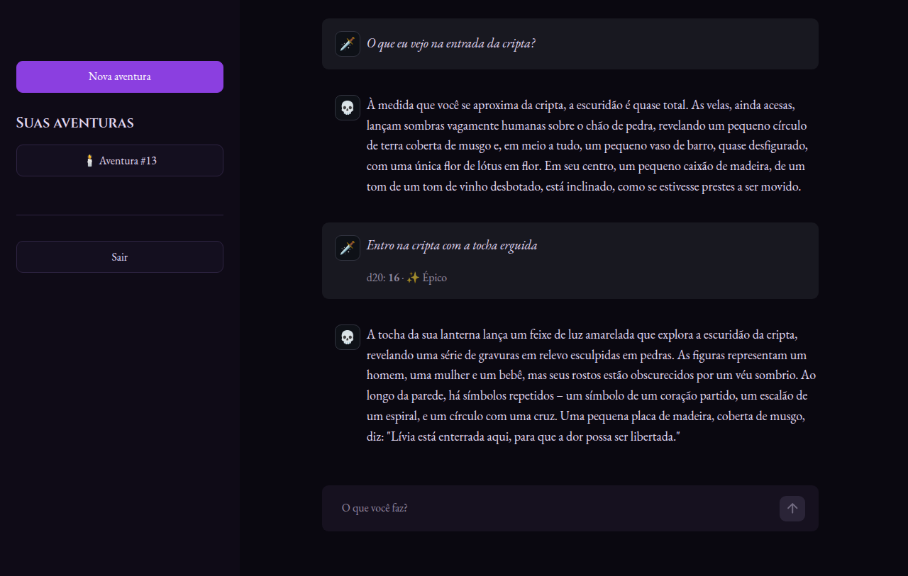

# Umbra

**Um mestre de RPG feito com IA, para jogar uma aventura de dark fantasy sozinho.**

Você descreve o que seu personagem faz, um d20 decide se dá certo e a IA narra o que acontece, em tempo real. A IA roda localmente com o [Ollama](https://ollama.com), sem API paga e sem precisar de placa de vídeo.



## Sobre o projeto

A ideia era jogar RPG sem precisar de um mestre humano, mas mantendo a sensação de mesa: você escreve livremente o que quer fazer, e o resultado tem consequências.

O princípio do projeto é **simplicidade**: uma única aventura, regras que cabem em um parágrafo e o mínimo de peças pra funcionar bem. A IA não decide se você teve sucesso. Quem decide é o dado, rolado pelo servidor. A IA só conta a história do resultado, o que deixa o jogo justo e impede que um modelo pequeno "invente" vitórias.

## Como jogar

Você chega a **Vel'Mora**, uma vila isolada onde os mortos deixaram de descansar há sete noites. O sino da capela toca sozinho à meia-noite, e a cripta da família Aldren está aberta. Sua missão: descobrir o que despertou os mortos e dar um fim nisso.

1. Crie uma conta e clique em **Nova aventura**.
2. Leia a cena e escreva o que seu personagem faz, do jeito que quiser: *"Entro na cripta com a tocha erguida"*, *"Ataco o esqueleto"*, *"Procuro pistas no altar"*.
3. A cada ação o servidor rola um **d20**:

   | Dado    | Resultado | O que acontece                              |
   |---------|-----------|---------------------------------------------|
   | 1 a 9   | 🩸 Falha   | Dá errado, com uma consequência concreta    |
   | 10 a 15 | ⚔️ Sucesso | Dá certo, por pouco                         |
   | 16 a 20 | ✨ Épico   | Dá certo de forma grandiosa, sem se ferir   |

4. Quer só entender a cena? Termine a frase com **`?`** (*"O que tem em cima do altar?"*). Perguntas não rolam dado: o mestre apenas responde.
5. A aventura tem **12 turnos**. Perto do fim a história caminha para o clímax, e o último turno traz o desfecho.

Existe um segredo por trás do que está acontecendo na vila, e o mestre revela uma pista por vez. Suas aventuras ficam salvas e podem ser retomadas pela barra lateral.

## Destaques técnicos

- **Narração em tempo real (SSE).** O texto aparece enquanto a IA escreve, então a primeira frase surge em poucos segundos, mesmo rodando só em CPU.
- **Modelo escolhido por teste.** Comparei `gemma3:1b`, `gemma3:4b`, `qwen2.5:1.5b` e `qwen3:4b` numa máquina comum (8 núcleos, só CPU). O `gemma3:4b` escrevia melhor, mas levava mais de um minuto por turno. O `qwen2.5:1.5b` ignorava o resultado do dado. O `gemma3:1b` foi o equilíbrio: rápido e obediente ao resultado.
- **Aproveitamento do cache do Ollama.** O Ollama só reaproveita o que já processou se o começo do pedido for idêntico ao anterior. Por isso o histórico da partida é recriado exatamente como foi enviado, sem cortes. Com isso, a primeira palavra de cada turno caiu de ~15 s (e crescendo) para ~3 s constantes.
- **Dado salvo antes da narração.** A rolagem é gravada no banco antes de a IA começar a escrever. Se a conexão cair, a nova tentativa usa o mesmo dado e a mesma ação, então não dá pra recarregar a página até tirar 20.
- **Desconexão tratada.** Se o jogador fecha a aba no meio da narração, a geração é interrompida na hora, liberando a IA para os outros jogadores.
- **Prompt pensado para modelo pequeno.** Instruções curtas e diretas, o lembrete de tamanho repetido no fim do pedido (onde um modelo pequeno presta mais atenção) e um enredo escondido para a história ter para onde ir.

## Stack

| Parte           | Tecnologia                                         |
|-----------------|----------------------------------------------------|
| Backend         | Python 3.12, FastAPI, SQLAlchemy, SQLite           |
| Autenticação    | JWT (PyJWT) com senhas em Argon2                   |
| IA              | Ollama com `gemma3:1b`, rodando local em CPU        |
| Frontend        | Streamlit                                          |
| Infra           | Docker Compose                                     |
| Testes          | pytest                                             |

## Arquitetura

```
 Navegador ──► Frontend (Streamlit :8501) ──HTTP/SSE──► Backend (FastAPI :8000) ──► Ollama (:11434)
                                                              │
                                                              └──► SQLite
```

O backend segue MVC com uma camada de serviços:

```
backend/app/
├── controllers/   rotas HTTP (auth, usuários, jogos) e dependências
├── services/      regras do jogo, sem nada de HTTP
│   ├── game_service.py   turnos, dado, salvamento da narração
│   ├── narrator.py       prompts enviados à IA
│   └── dice.py           d20 e faixas de resultado
├── models/        tabelas (SQLAlchemy)
├── views/         formatos de entrada e saída da API (Pydantic)
└── core/          banco, segurança, cliente do Ollama
```

## Rodando com Docker (recomendado)

**Requisitos:** Docker com Docker Compose e cerca de 10 GB livres em disco (a imagem do Ollama é grande, e o modelo tem ~800 MB).

```bash
git clone git@github.com:NepoSales/Umbra-AI.git
cd Umbra-AI
docker compose up -d --build
```

Abra **http://localhost:8501** para jogar. A documentação interativa da API fica em http://localhost:8000/docs.

Na primeira vez o compose baixa o modelo `gemma3:1b`, então o backend demora um pouco para subir. Dá pra acompanhar com:

```bash
docker compose logs -f ollama-pull
```

Para parar:

```bash
docker compose down      # para os containers, mantendo contas, partidas e o modelo
docker compose down -v   # apaga também os volumes (banco e modelo)
```

O Ollama do compose não publica porta na máquina, então não conflita com um Ollama que você já tenha instalado.

## Rodando sem Docker (desenvolvimento)

**Requisitos:** Python 3.12 e o [Ollama](https://ollama.com) instalado. Baixe o modelo uma vez:

```bash
ollama pull gemma3:1b
```

**Backend** (em um terminal):

```bash
cd backend
python3 -m venv .venv
.venv/bin/pip install -r requirements.txt
.venv/bin/uvicorn app.main:app --reload   # http://localhost:8000/docs
```

**Frontend** (em outro terminal, com o backend rodando):

```bash
cd frontend
python3 -m venv .venv
.venv/bin/pip install -r requirements.txt
.venv/bin/streamlit run app.py            # http://localhost:8501
```

## Configuração

Todas as variáveis são opcionais para jogar localmente.

| Variável             | Onde     | Padrão                          | Para que serve                         |
|----------------------|----------|---------------------------------|----------------------------------------|
| `UMBRA_SECRET_KEY`   | backend  | `dev-secret-troque-em-producao` | Chave que assina os tokens de login. **Troque se for expor o jogo na internet.** |
| `UMBRA_DATABASE_URL` | backend  | `sqlite:///./umbra.db`          | Endereço do banco                      |
| `UMBRA_OLLAMA_URL`   | backend  | `http://localhost:11434`        | Endereço do Ollama                     |
| `UMBRA_OLLAMA_MODEL` | backend  | `gemma3:1b`                     | Modelo usado como narrador             |
| `UMBRA_API_URL`      | frontend | `http://localhost:8000`         | Endereço do backend                    |

No Docker, os endereços já vêm configurados no `docker-compose.yml`.

## Testes

```bash
cd backend
.venv/bin/pytest
```

Os testes trocam a IA por uma resposta fixa, então rodam em segundos e não precisam do Ollama. Eles cobrem cadastro e login, o fluxo do jogo, as faixas do dado, as perguntas sem rolagem, o fim da aventura, a nova tentativa com o dado já salvo e o reaproveitamento do cache.

## API

| Método | Rota                   | Descrição                                       |
|--------|------------------------|-------------------------------------------------|
| POST   | `/users`               | Cria uma conta                                  |
| POST   | `/auth/login`          | Faz login e devolve o token JWT                 |
| GET    | `/users/me`            | Dados da conta logada                           |
| PATCH  | `/users/me`            | Atualiza nome, email ou senha                   |
| DELETE | `/users/me`            | Apaga a conta                                   |
| POST   | `/games`               | Começa uma aventura (narração via SSE)          |
| GET    | `/games`               | Lista suas aventuras                            |
| GET    | `/games/{id}`          | Aventura com todos os turnos                    |
| POST   | `/games/{id}/actions`  | Envia uma ação, rola o d20 e narra (SSE)        |

As rotas que narram respondem em [Server-Sent Events](https://developer.mozilla.org/docs/Web/API/Server-sent_events) com os eventos `start` (dado e resultado), `chunk` (pedaços do texto), `done` (texto final) ou `error`.

## Limitações conhecidas

- **O modelo é pequeno.** O `gemma3:1b` às vezes escreve frases estranhas ou passa do tamanho pedido. Modelos maiores escrevem melhor, mas ficam lentos demais em CPU.
- **Uma narração por vez.** Em CPU, gerar várias narrações em paralelo só divide o processador, então os pedidos fazem fila. Funciona bem para uso pessoal ou poucos jogadores.
- **Sem migrações de banco.** Mudanças nas tabelas exigem apagar o `umbra.db` (ou o volume do Docker).
